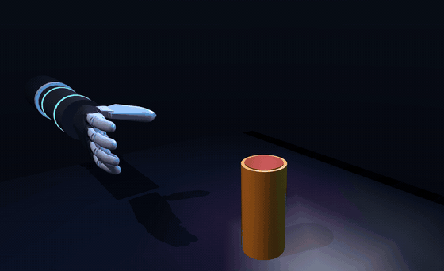
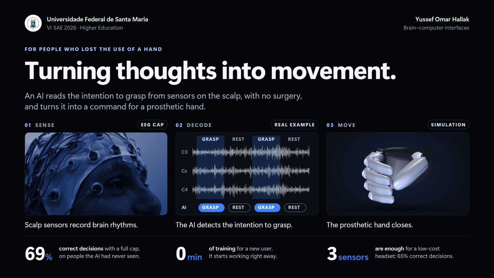

# Brain-Controlled Robotic Prosthetics

**A non-invasive brain-computer interface that turns the intention to grasp into the movement of a robotic arm.**

Real recorded brain signals from a person the AI had never seen, driving a simulated prosthetic hand.

## The problem

Pick up your pen. Your brain decided, and your hand obeyed. For people living with amputation or paralysis, that intention is still born in the brain. The message just never reaches the hand.

The most advanced brain-computer interfaces need electrodes implanted with surgery. That puts them out of reach for almost everyone who could use them.

## What this project does

This project reads brain signals (EEG) from sensors on the scalp, recognizes when a person imagines closing their hand, and uses that decision to control a robotic arm. It starts in simulation, then moves to a real arm.

It is designed around three ideas:

- **No surgery.** Sensors on the scalp instead of implants, trading some signal quality for safety and cost.
- **Ready from the first minute.** It works on new users with no calibration session.
- **One reliable decision.** The system focuses on the intention to grasp, the decision that matters most for a prosthetic hand.

## My work

I build the machine learning side: the models that classify EEG signals and decide when the person intends to grasp.

## Presented at

- VI SAE 2026, UFSM: "Turning Thoughts into Movement: Brain-Controlled Robotic Prosthetics".
- JAI 2025, UFSM.

## What's next

Taking the system from simulation to a physical robotic arm.

## About

Independent research by Yussef Omar Hallak, Control and Automation Engineering, UFSM.

The source code is private. Reviewers and hiring teams can request access at yussefomarh@gmail.com.
